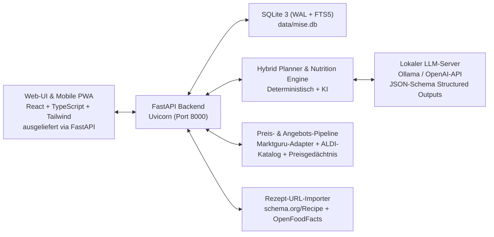

# SPEC.md — Miseclon (Lokaler Meal-Planner & Einkaufs-Assistent)

## 1. Produktvision & Zielsetzung
**Miseclon** ist eine lokal gehostete, out-of-the-box lauffähige Windows-Web-App (inspiriert von **Mise**), die alltagstaugliche Wochenplanung, exaktes Makro-Tracking (**Fokus: Protein & komplexe Kohlenhydrate**), einstellbare **Koch-Einfachheit (Effort-Level)**, **Personenzahl-Skalierung**, **Resteverwertung** und **automatische Einkaufslisten mit ALDI-Basispreisen & PLZ-Wochenangeboten** vereint.

Die App läuft vollständig lokal auf Windows ohne Docker in einem einzigen Prozess (`FastAPI` + `SQLite` + gebautes `React`-Frontend) und bindet optional einen lokalen LLM-Server (**Ollama** / OpenAI-kompatible API auf einer 24-GB-VRAM-GPU) mit strikten JSON-Schema Structured Outputs an. Auch ohne laufenden LLM-Server ist die App sofort vollständig nutzbar.

---

## 2. Systemarchitektur & Tech-Stack

| Schicht | Technologie | Begründung |
|---|---|---|
| **Backend** | Python 3.12+, FastAPI, Uvicorn, Pydantic v2 | Schlank, typensicher, asynchron, direkt auf Windows lauffähig. |
| **Python-Env** | Lokales `.venv` + `requirements.txt` | Keine Zusatzinstallation nötig, voll reproduzierbar. |
| **Datenbank** | SQLite 3 (`WAL`, `FOREIGN KEYS ON`) + SQLAlchemy 2.0 | Einzeldatei `data/mise.db`, Zero-Ops, einfaches Backup. |
| **Frontend** | React + TypeScript + Vite + Tailwind CSS + Lucide Icons | Mise-inspiriertes UI, gebaut in `frontend/dist` und direkt von FastAPI ausgeliefert (1 Prozess im Betrieb, per LAN auch am Smartphone nutzbar). |
| **KI-Anbindung** | `httpx` gegen OpenAI-kompatible API (`/v1/chat/completions`) + Ollama Modell-Discovery (`/api/tags`) | Läuft mit Ollama, LM Studio, llama.cpp, vLLM. Strikte JSON-Schema-Validation + Self-Repair-Retry. |
| **Preis-Pipeline** | `PriceProvider`-Interface + Marktguru-PLZ-Adapter + `rapidfuzz` + Negativ-Keywords + ALDI-Basispreise | 100 % stabil auch offline; Live-Wochenangebote optional abrufbar. |

---

## 3. Lokale KI-Anbindung (24-GB-VRAM-GPU)
- **Zuständigkeitsgrenze:** Das LLM übernimmt kreative Planung, Rezept-Generierung und optionales Matching-Disambiguation. **Python & SQLite bleiben alleinige Wahrheitsquelle** für Summen, Grammzahlen, Makros, Pantry-Abzüge und Euro-Preise.
- **Structured Outputs:** Übergabe von `response_format={"type": "json_schema", ...}` (mit automatischem Fallback auf JSON-Mode für ältere Server) + strikte Pydantic-v2-Validierung + bis zu 2 Self-Repair-Retries bei semantischen Fehlern.
- **Empfohlene Modelle (24 GB VRAM):** `qwen2.5:14b`, `qwen2.5:32b`, `qwen3:14b`, `qwen3:32b`, `gemma3:27b`, `mistral-small3.1:24b`.
- **Hybrid-Betrieb:** Ist Ollama nicht gestartet, nutzt die Wochenplanung nahtlos den deterministischen Scoring-Planer über die eingebaute Rezeptbibliothek (42+ kuratierte Gerichte + eigene/importierte Rezepte).

---

## 4. Preis- & Angebots-Pipeline
### 3-Schicht-Auflösungs-Kaskade je Zutat
1. **Aktives Wochenangebot (`promo`)**: PLZ-basiert über den Marktguru-Adapter (ALDI Nord/Süd, REWE, LIDL, EDEKA, Kaufland, Penny, Netto), gecacht bis `valid_to`, mit Circuit-Breaker & Rate-Limiting.
2. **Verifizierter Nutzerpreis (`verified`)**: Vom Nutzer in der Einkaufsliste eingetragene reale Kassenpreise (`price_history`) oder manuell angepasste Marktpreise.
3. **ALDI-Referenzpreis (`estimated`)**: Vorbefüllter Katalog mit ~140+ deutschen Grundzutaten inkl. realistischer ALDI-Packungsgrößen und Grundpreise (€/kg, €/l, €/Stk).

### 3-stufiges Angebots-Matching
1. **Einheiten- & Packungsgrößen-Parser:** Erkennt deutsche Mengenangaben (`400g`, `500 ml`, `6x1,5L`, `10 Stück`, `1 kg`) und normiert auf Grundpreise.
2. **Fuzzy- & Negativ-Keyword-Matching (`rapidfuzz`):** Nutzt Synonyme (`ingredient_aliases`) und Ausschlusswörter (`exclude_keywords`), um Fehlmatches wie *Hähnchenbrust → Hähnchenbrust-Aufschnitt* oder *Haferflocken → Haferdrink* zu verhindern.
3. **Nutzer-Review & optionales LLM-Disambiguation:** Bestätigte und abgelehnte Matches (`is_rejected`) werden dauerhaft in `ingredient_offer_matches` gespeichert.

---

## 5. Datenmodell (SQLite-Tabellen)
1. `app_settings` — PLZ, bevorzugte Märkte, Standard-Personenzahl, Wochenbudget, Makro-Ziele (`kcal`, `protein_g`, `carbs_g`, `fiber_g`, `fat_g`, `prefer_complex_carbs`), max. Effort-Level, Ausschlüsse, LLM-Endpoint & Modell.
2. `ingredients` — Kanonische Grundzutaten (Kategorie/Supermarkt-Gang, Basiseinheit, `grams_per_unit`, Makros pro 100 g inkl. `sugar_100`, `fiber_100`, `carb_type`, Haltbarkeit, Standard-ALDI-Packungsgröße & Referenzpreis).
3. `ingredient_aliases` — Synonyme und `exclude_keywords_json`.
4. `stores` — Konfigurierte Supermarktketten (Default: ALDI Süd, ALDI Nord, LIDL, REWE, EDEKA, Kaufland).
5. `price_offers` — Gecachte Angebote mit Rohdaten, Preis, Grundpreis, Packungsgröße, Gültigkeit und Quelle.
6. `ingredient_offer_matches` — Zuordnung `ingredient_id ↔ offer_id` inkl. Methode, Confidence und Reject-Flag.
7. `price_history` — Historische Preise & real gezahlte Einkaufspreise.
8. `pantry_items` — Vorratsschrank (`fridge`, `freezer`, `pantry`) mit Menge, Einheit, Ablaufdatum und Priorität.
9. `recipes` & `recipe_ingredients` — Rezepte inkl. **Effort-Level (1–3)**, Prep-/Cook-Zeit, kompletter Schritt-für-Schritt-Zubereitung, Tags, Quelle (`seed`, `llm`, `url_import`, `manual`) und deterministisch berechneten Makros & Kosten pro Portion.
10. `meal_plans` & `meal_plan_entries` — Wochenpläne inkl. eingestellter **Personenzahl**, Budget, Effort-Limit, Tages-Slots, **`is_leftover_from_entry_id`** (Batch-Cooking) und **`is_cooked`** (Pantry-Abbuchung).
11. `shopping_lists` & `shopping_list_items` — Konsolidierte Einkaufsliste mit Bedarf, Pantry-Abzug, Netto-Kaufmenge, gerundeten Packungen, Packungs-Restmenge, Preis-Confidence, tatsächlichem Preis und Abhak-Status.
12. `sync_runs` & `llm_generation_logs` — Betriebs- und Diagnose-Protokolle.

---

## 6. Kern-Features (Mise-inspiriert)
- **Wochenplan-Cockpit:** 7-Tage-Week-Ribbon mit Fortschritts-Indikatoren, einstellbare **Personenzahl (1–6)**, **Koch-Einfachheit (1 Ultra-Simpel / 2 Alltag / 3 Ambitioniert)**, Budget, aktive Slots und Batch-Cooking.
- **Transparenz pro Mahlzeit:** Jede Mahlzeit-Karte zeigt sofort `kcal`, `Protein`, `KH` (mit Komplex-KH- & Ballaststoff-Fokus), `Fett`, Effort-Badge, Zeit und geschätzten ALDI-Preis — plus vollständige **Schritt-für-Schritt-Zubereitung** im Detail-Drawer & Kochmodus.
- **1-Klick-Slot-Swap:** Einzelne Mahlzeiten gezielt gegen einfachere, proteinreichere, günstigere oder KI-generierte Alternativen tauschen.
- **Konsolidierte Einkaufsliste:** Automatisch `Wochenplan − Pantry`, sortiert nach Supermarkt-Gang oder Markt, mit Packungsgrößen, Restmengen-Hinweis, Ist-Preis-Erfassung und „Abgehakte in Vorrat übernehmen“.
- **Resteverwertung:** Ablauf-Warnungen im Vorratsschrank, „Was koche ich aus meinen Resten?“-Empfehlungen, Batch-Cooking-Verknüpfung und automatischer Pantry-Abzug beim Abhaken als „Gekocht“.
- **Rezept-Bibliothek + URL-Importer + KI-Generator:** 42+ kuratierte deutsche High-Protein-/Komplexe-KH-Rezepte vorinstalliert, 1-Klick-Import einzelner Rezept-URLs (`schema.org/Recipe`, z. B. Chefkoch/EatSmarter/REWE) und lokale KI-Generierung.

---

## 7. Betrieb unter Windows (Out of the Box)
- Start per Doppelklick auf `start.bat` (oder `.\start.ps1`).
- Web-App lokal erreichbar unter `http://127.0.0.1:8000` (und im heimischen WLAN über `http://<PC-IP>:8000` fürs Smartphone im Supermarkt).
